# GLPI IT Service Desk & Ticketing Lab

A working IT service desk built on top of an existing Active Directory lab. GLPI 11 runs on a hardened Ubuntu server, authenticates users against AD over LDAPS, routes tickets to a technician group with SLA timers, inventories endpoints automatically with the GLPI Agent, and keeps a knowledge base written from real resolved tickets.

> **Built on:** [Enterprise Active Directory Lab](https://github.com/meet246/Active-Directory-Enterprise-Lab). GLPI was added to the existing `corp.local` domain (DC01 + CLIENT01).

---

## Table of Contents

- [What I Built](#what-i-built)
- [Lab Architecture](#lab-architecture)
- [Environment](#environment)
- [Phase 1: GLPI Server](#phase-1-glpi-server)
- [Phase 2: AD Integration over LDAPS](#phase-2-ad-integration-over-ldaps)
- [Phase 3: Service Desk Structure](#phase-3-service-desk-structure)
- [Phase 4: Asset Inventory](#phase-4-asset-inventory)
- [Scenario 1: Password Reset](#scenario-1-password-reset)
- [Scenario 2: New User Onboarding](#scenario-2-new-user-onboarding)
- [Challenges & Troubleshooting](#challenges--troubleshooting)
- [Skills Demonstrated](#skills-demonstrated)
- [Repo Contents](#repo-contents)

---

## What I Built

<!-- TODO (Jack): rewrite this section in your own words. -->

I wanted hands-on help desk experience with a real ticketing system, not just a line on a resume. So I added a GLPI service desk to my Active Directory lab and ran it like a small company's IT desk: AD users log in with their domain accounts, tickets are routed to a tech group automatically with SLA due dates, the tech fixes the actual problem in AD or on the endpoint, documents the fix as a knowledge base article, and closes the ticket.

Along the way I hit (and documented) ten real problems, from a multi-homed domain controller registering two IPs in DNS to Windows Server 2025 refusing cleartext LDAP binds, which I solved by standing up an enterprise CA and moving GLPI to LDAPS instead of weakening the DC.

---

## Lab Architecture

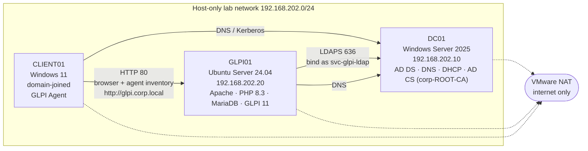

Each VM has a second NIC on VMware NAT for internet access (updates, downloads). Lab traffic stays on the host-only network, and every service is reached by hostname (`dc01.corp.local`, `glpi.corp.local`), not IP.

---

## Environment

| Component | Details |
|---|---|
| Hypervisor | VMware Workstation |
| Domain | `corp.local` |
| Domain Controller | DC01, Windows Server 2025 (AD DS, DNS, DHCP, AD CS Enterprise Root CA) |
| Service desk server | GLPI01, Ubuntu Server 24.04 LTS, 1.5 GB RAM |
| Web stack | Apache 2 + `libapache2-mod-php`, PHP 8.3, MariaDB |
| ITSM | GLPI 11.0.9 |
| Client | CLIENT01, Windows 11, domain-joined, GLPI Agent |
| Auth | LDAPS (636) to DC01 with a least-privilege bind account |

---

## Phase 1: GLPI Server

- Built an Ubuntu Server VM with two NICs: NAT via DHCP for internet, and a static `192.168.202.20` on the lab network with DNS pointed at DC01 ([netplan config](configs/netplan-glpi01.yaml)).
- Added a `glpi.corp.local` A record on DC01.
- Installed Apache, PHP 8.3 with all of GLPI's required extensions, and MariaDB. Ran `mariadb-secure-installation` and created a dedicated `glpi` database with a user that only has rights on that database.
- Installed GLPI 11 using the **FHS layout**: code in `/var/www/glpi` owned by root (not writable by Apache), config in `/etc/glpi`, data in `/var/lib/glpi`, logs in `/var/log/glpi`. Apache's DocumentRoot is `public/` only ([vhost config](configs/glpi.conf)).
- Hardening after install: personal Super-Admin account created, the four default accounts disabled, `install.php` removed, PHP session cookie settings fixed, DB backup taken, VM snapshot.

| | |
|---|---|
| 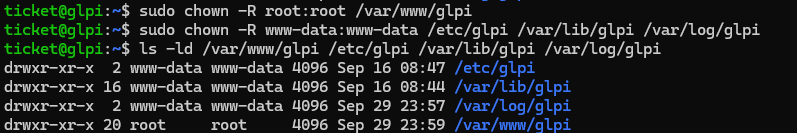 | 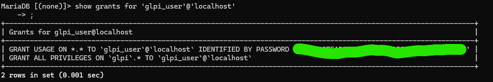 |
| Code owned by root, writable dirs owned by `www-data` | GLPI DB user limited to the `glpi` database |
| 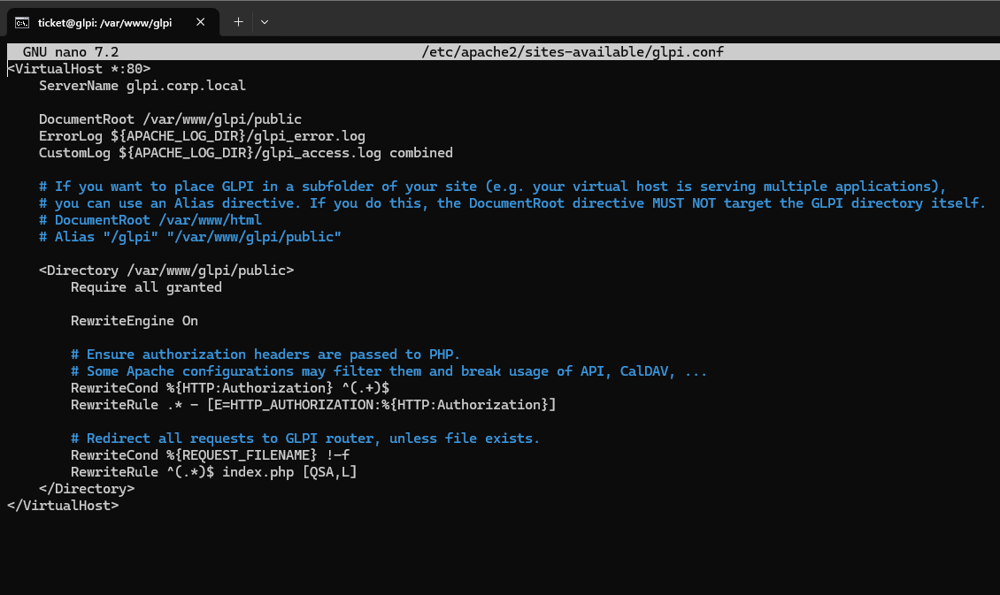 | 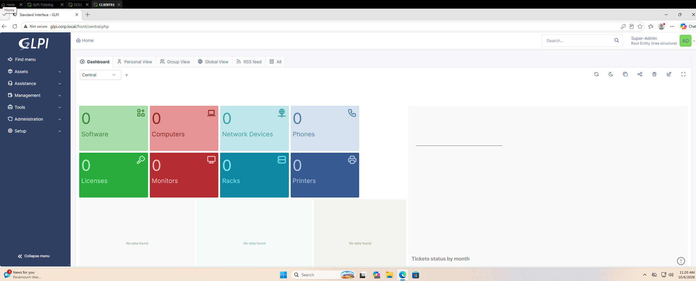 |
| Apache vhost serving only `public/` | **Done when:** CLIENT01 reaches `http://glpi.corp.local` by name and logs in as the new admin |

---

## Phase 2: AD Integration over LDAPS

- Created a `svc-glpi-ldap` bind account (Domain Users only) in a `Service Accounts` OU, a `GLPI-Techs` security group, and test users.
- DC01 rejected simple binds on port 389 (LDAP signing is enforced on Server 2025), so I installed **AD CS** as an Enterprise Root CA, let DC01 enroll a Domain Controller certificate, trusted the root CA on GLPI01, and pointed GLPI at `ldaps://dc01.corp.local:636`.
- Configured the directory for AD (`samaccountname` login field, user/person filter, `objectguid` sync field) and imported users.
- **Authorization rules:** members of `GLPI-Techs` get the **Technician** profile; everyone else gets **Self-Service**. Users are provisioned automatically on first login.

| | |
|---|---|
| 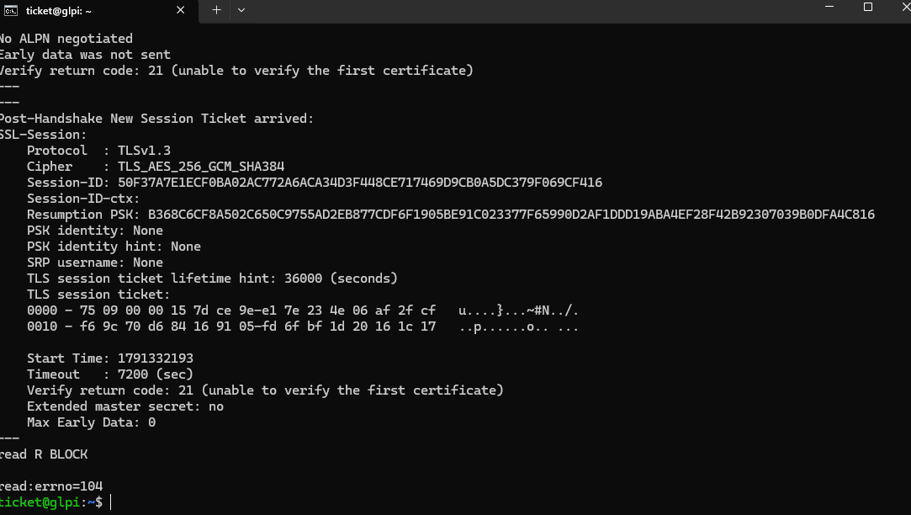 | 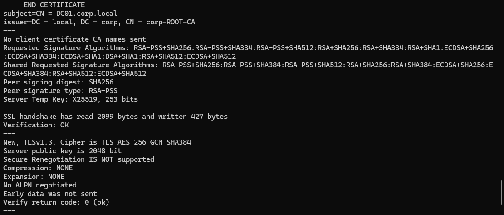 |
| Before: GLPI01 doesn't trust DC01's certificate (code 21) | After trusting `corp-ROOT-CA`: `Verify return code: 0 (ok)` |
| 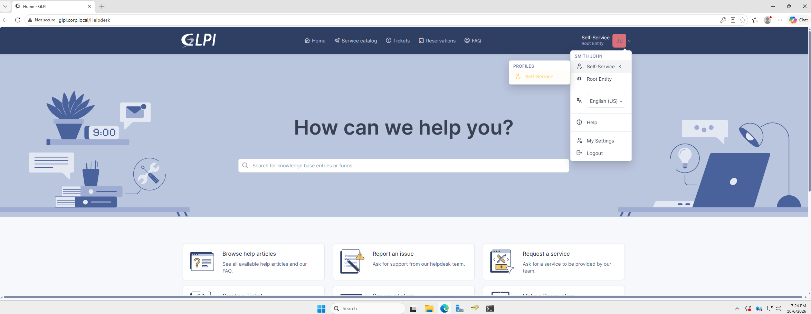 | 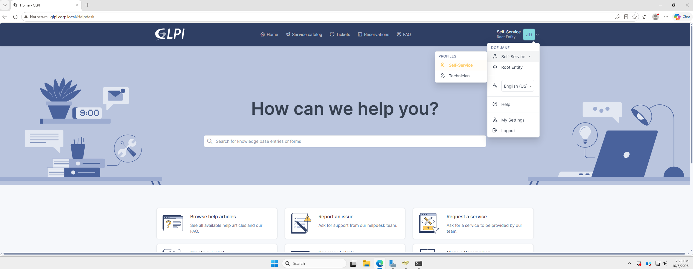 |
| Normal AD user → Self-Service | `GLPI-Techs` member → Technician (+ Self-Service) |

*(Phase 2 screenshots show "Root Entity". Users were moved to the IT Service Desk entity in Phase 3.)*

---

## Phase 3: Service Desk Structure

- **Entity:** `IT Service Desk` under root, so a future Security Operations entity can sit beside it without either team seeing the other's tickets. Authorization rules place users into this entity.
- **Tech group:** `IT Service Technicians`, assignable, in IT Service Desk.
- **Ticket categories:** 5 parents (Account & Access, Onboarding & Offboarding, File & Share Access, Workstation & Network, Software & Printing) with 9 children, each flagged for incidents and/or requests.
- **SLAs:** a `Business Hours` calendar (Mon–Fri 8–17) and a Time to Own + Time to Resolve target for every priority level from Very low to Very high.
- **Business rules:** one rule routes every new IT Service Desk ticket to the tech group; one rule per priority applies the matching SLAs.
- **Knowledge base categories** matching the 5 ticket categories, kept flat and non-recursive.

| | |
|---|---|
| 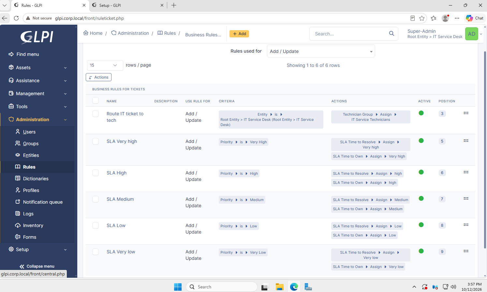 | 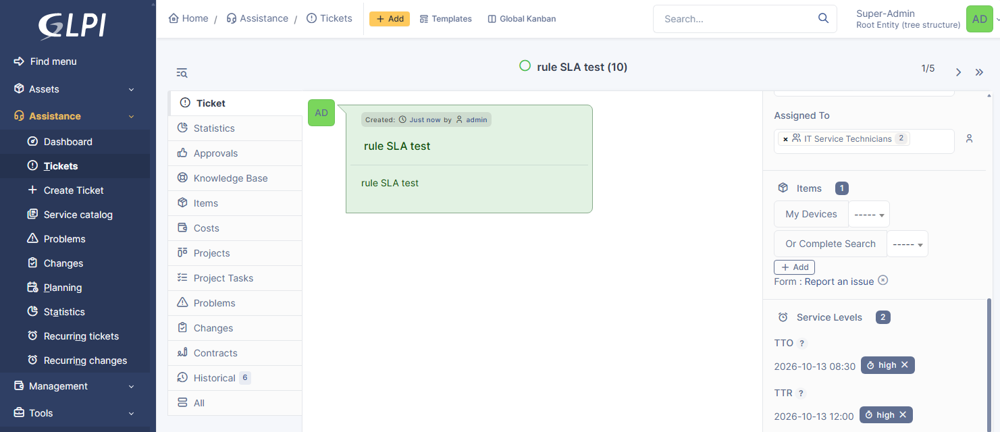 |
| Routing rule + one SLA rule per priority | **Done when:** a new ticket gets the tech group and both SLA due dates automatically |

---

## Phase 4: Asset Inventory

- Enabled GLPI's native inventory and installed the **GLPI Agent** on CLIENT01, reporting to `http://glpi.corp.local`.
- Added an entity rule: computers whose domain is `corp.local` go to IT Service Desk. Non-domain machines stay in root, which works as an "unmanaged device" signal.
- CLIENT01 reports its hardware, OS, volumes, and 146 software packages with no manual entry, and techs can link it to tickets.

| | |
|---|---|
| 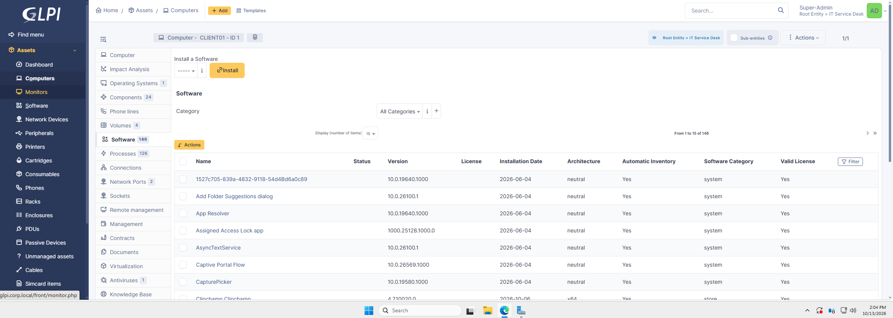 | 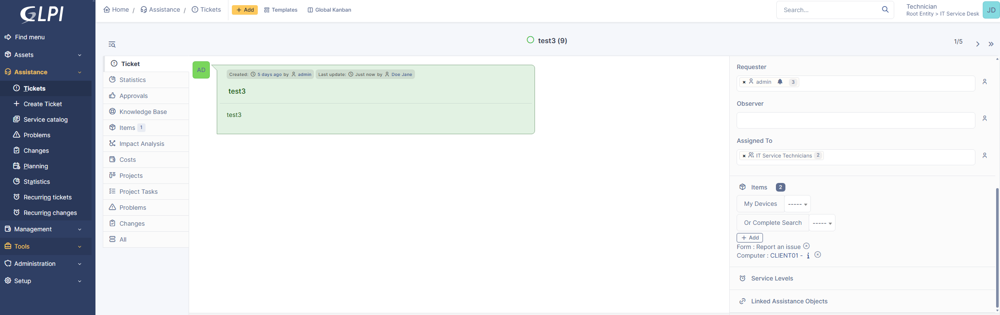 |
| CLIENT01 in IT Service Desk with automatic software inventory | Technician links CLIENT01 to a ticket |

---

## Scenario 1: Password Reset

A user calls the help desk because they forgot their password.

1. The ticket is logged as a **Request** in *Account & Access > Password reset*. The routing rule assigns it to `IT Service Technicians` and the SLA rule sets Time to Own and Time to Resolve due dates.
2. **Identity is verified before anything changes:** callback to the phone number on file in AD plus manager confirmation, recorded as a follow-up. (Caller ID and knowledge questions alone are not verification; help desk social engineering is a common way into companies.)
3. Password reset in ADUC with **User must change password at next logon**, so the tech never knows the user's final password.
4. The user signs in and sets a new password; the solution is added, approved, and the ticket closed.
5. The fix became a tech-only [KB article](kb-articles/reset-ad-password.md).

| | |
|---|---|
| 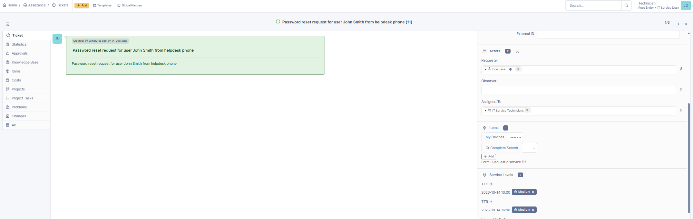 | 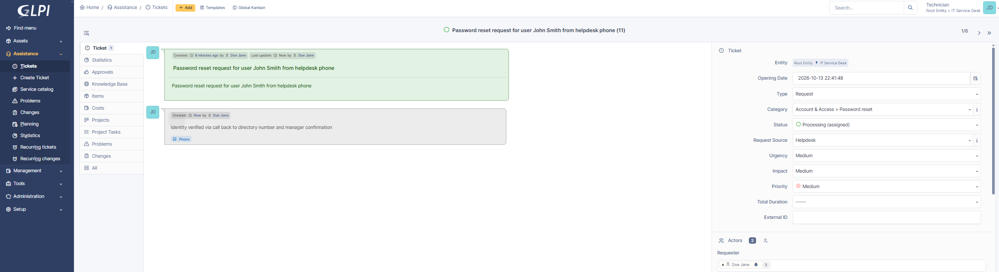 |
| Auto-assigned to the tech group with SLA due dates | Identity verification recorded on the ticket |
| 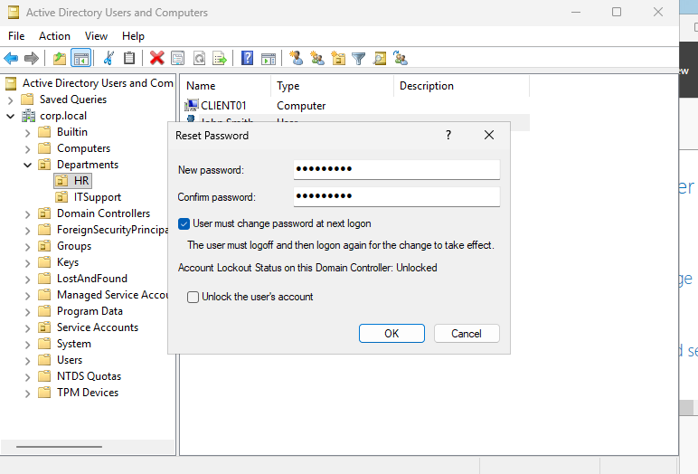 | 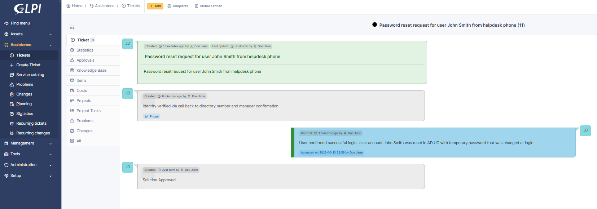 |
| Reset with "must change password at next logon" | Solution approved and ticket closed |

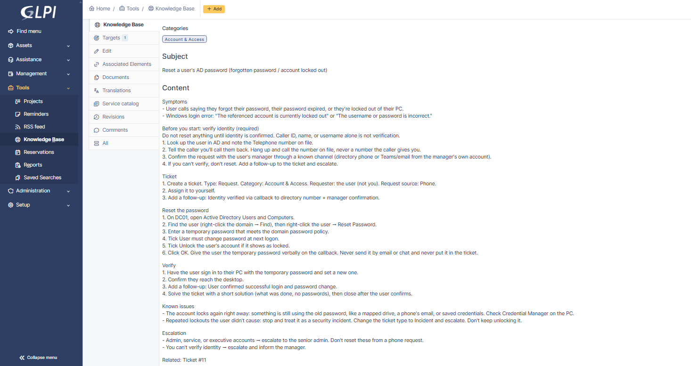

---

## Scenario 2: New User Onboarding

A hiring manager requests an account for a new HR employee starting the next day.

1. Onboarding request logged in *Onboarding & Offboarding*, auto-assigned with SLA due dates (High priority).
2. A ticket **task** breaks the work into steps: create AD account, add to groups, assign workstation, verify first login.
3. New user created in the HR OU with a temporary password and "must change at next logon".
4. First sign-in on CLIENT01 forces the password change. The new user then logs in to GLPI and is **provisioned automatically** with the Self-Service profile in IT Service Desk, with no manual GLPI setup. This shows the Phase 2 rules working end-to-end.
5. The solution was saved straight to the knowledge base with GLPI's "Save & add to the knowledge base" option, then expanded into a full [onboarding checklist](kb-articles/new-user-onboarding.md).

| | |
|---|---|
| 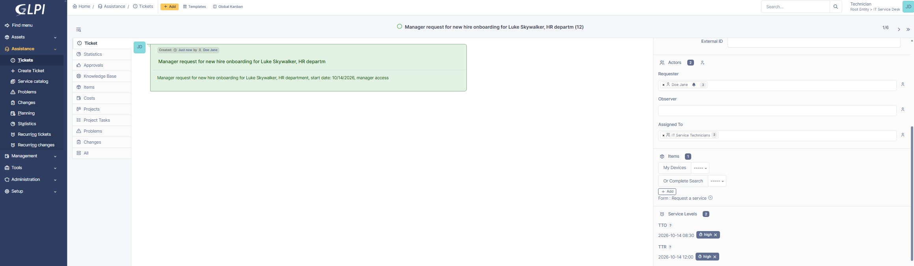 | 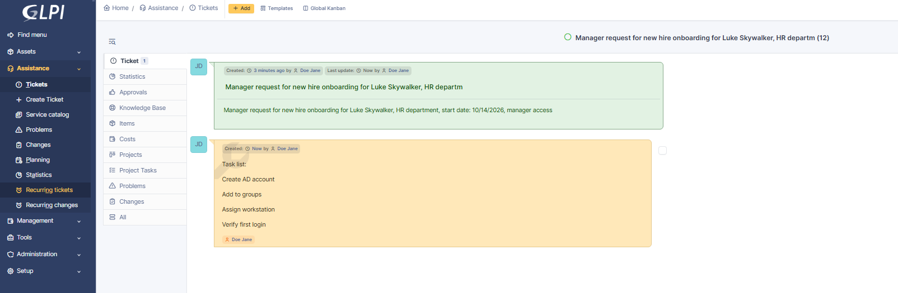 |
| Onboarding request with SLA due dates | Task list on the ticket |
|  | 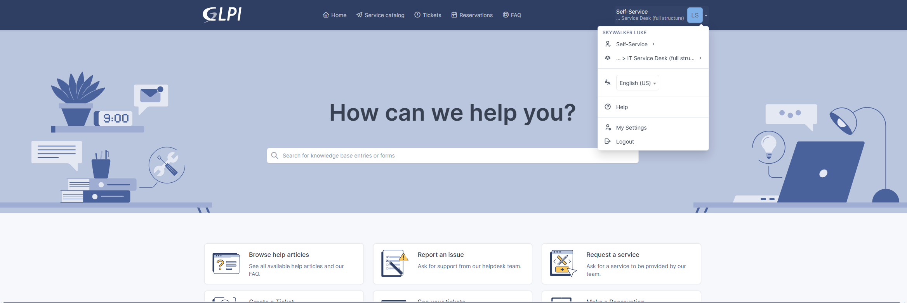 |
| First Windows sign-in forces a password change | New user lands in GLPI as Self-Service, IT Service Desk |

---

## Challenges & Troubleshooting

Real problems hit during the build, written up as symptom → cause → fix → lesson.

<details>
<summary><b>1. Domain controller hostname resolves to two IPs</b></summary>

- **Symptom:** `nslookup dc01.corp.local` from GLPI01 returned both the lab IP and a NAT IP.
- **Cause:** DC01 has two NICs, and Windows registers every adapter's IP in DNS by default. LDAP binds would have failed intermittently.
- **Fix:** turned off DNS registration on DC01's NAT adapter, made DNS listen only on the lab IP, deleted the stale records, re-registered. GLPI01 still returned both IPs until its `systemd-resolved` cache was flushed.
- **Lesson:** query the DNS server directly to tell a server problem from a client cache problem.
</details>

<details>
<summary><b>2. Client DNS times out after fixing #1</b></summary>

- **Symptom:** CLIENT01's `nslookup glpi.corp.local` timed out against `192.168.157.10`.
- **Cause:** DC01's own DHCP scope was still handing out its NAT IP as the DNS server, the address DNS no longer listened on. The scope's pool also overlapped VMware's DHCP.
- **Fix:** scope option 006 → `192.168.202.10`, pool shrunk to stop the overlap, verified with a fresh lease and `netsh interface ipv4 show dnsservers`. On GLPI01, netplan `dhcp4-overrides` stopped the NAT NIC from using DHCP-provided DNS.
- **Lesson:** before narrowing where a service listens, check what depends on the old address. A manual fix on one client isn't a fix if DHCP keeps handing out the bad setting.
</details>

<details>
<summary><b>3. GLPI code owned by my user account instead of root</b></summary>

- **Cause:** `tar` run as root restores the archive's stored UID (1000), which on Ubuntu is the first user created.
- **Fix:** `chown -R root:root` on the code; `www-data` only on config, data, and logs.
- **Lesson:** check ownership after extracting third-party archives as root. A non-root user owning web app code is a real risk.
</details>

<details>
<summary><b>4. Browser shows PHP source code instead of the app</b></summary>

- **Cause:** PHP and its extensions were installed, but not Apache's PHP module, so `.php` files were served as text. This is a source-code disclosure vulnerability.
- **Fix:** `libapache2-mod-php`, restart, verified `php_module` loaded. Secrets stayed safe because config lives outside the web root.
- **Lesson:** verify PHP actually executes, not just that Apache serves pages.
</details>

<details>
<summary><b>5. LDAP bind refused: "Strong(er) authentication required (8)"</b></summary>

- **Cause:** Windows Server 2025 enforces LDAP signing, so a cleartext simple bind on port 389 is rejected.
- **Fix:** instead of weakening the DC, installed AD CS (Enterprise Root CA), DC01 auto-enrolled a Domain Controller certificate, trusted the root CA on GLPI01 (`update-ca-certificates`), and switched GLPI to `ldaps://dc01.corp.local:636`. `openssl s_client` went from verify code 21 to 0. A second error (`Invalid DN syntax (34)`) was a BaseDN typed as `corp.local` instead of `DC=corp,DC=local`.
- **Lesson:** error 8 is a policy decision, so encrypt the channel rather than loosening the policy. Test TLS from the command line before the application.
</details>

<details>
<summary><b>6. AD login fails and user search returns nothing</b></summary>

- **Cause:** the directory still had OpenLDAP-style defaults: login field `uid` instead of `samaccountname`, a blank connection filter, and the wrong sync field.
- **Fix:** `samaccountname`, `(&(objectClass=user)(objectCategory=person))`, `objectguid`.
- **Lesson:** "bind works" and "users are found" are different checks.
</details>

<details>
<summary><b>7. Technician can't assign tickets to the tech group</b></summary>

- **Cause:** the Technician profile was missing the *Assign a ticket* and *See assigned* rights.
- **Fix:** added the rights; a fresh session picked them up.
- **Lesson:** when one account can do something and another can't, compare profile rights, not the object.
</details>

<details>
<summary><b>8. Business rule matches in Test but never runs</b></summary>

- **Cause:** the rule was created while root was the active entity, so it was scoped to root, and it wasn't active.
- **Fix:** moved the rule to IT Service Desk and activated it.
- **Lesson:** GLPI objects belong to whichever entity was active when they were created. The Test button checks criteria, not whether the rule is active or in scope.
</details>

<details>
<summary><b>9. GLPI Agent page has no "Force an Inventory" link</b></summary>

- **Cause:** the agent only shows the link to trusted source addresses, and `localhost` resolved to the IPv6 loopback `::1`.
- **Fix:** browsed to `http://127.0.0.1:62354` instead.
- **Lesson:** `localhost` and `127.0.0.1` aren't always the same on Windows.
</details>

<details>
<summary><b>10. Inventoried computer lands in root, invisible to techs</b></summary>

- **Cause:** with no entity rule, new inventory goes to root. After adding the rule, CLIENT01 still stayed in root, because entity rules apply when an item is created, not to existing items.
- **Detour:** I cleared the Domain field by hand while testing, and inventory stopped refilling it. GLPI locks fields you edit manually; fixed on the computer's Locks tab.
- **Fix:** one-time move with *Add to transfer list* → transfer to IT Service Desk. It stayed there after the next inventory.
- **Rejected:** making the computer recursive in root. It would have worked, but it breaks entity isolation and hides the bug.
- **Lesson:** import rules affect new items; existing items need a one-time transfer.
</details>

---

## Skills Demonstrated

- **ITSM / help desk:** ticket lifecycle, request vs. incident, categories, SLAs with business hours, routing rules, tasks, knowledge base management
- **Identity & access:** AD users/groups/OUs, LDAP/LDAPS integration, least-privilege service account, role-based profiles, help desk identity verification
- **PKI:** AD CS Enterprise Root CA, certificate trust on Linux, TLS troubleshooting with `openssl`
- **Linux administration:** Ubuntu Server, netplan, systemd-resolved, Apache, PHP, MariaDB hardening, file ownership and permissions
- **Networking:** DNS records, multi-homed DNS registration, DHCP scope options, dual-NIC routing
- **Asset management:** GLPI Agent, automated inventory, entity assignment rules
- **Troubleshooting & documentation:** 10 documented issues, KB articles written from real tickets

---

## Repo Contents

```
├── README.md
├── configs/
│   ├── glpi.conf               # Apache virtual host
│   └── netplan-glpi01.yaml     # dual-NIC network config
├── kb-articles/
│   ├── reset-ad-password.md
│   └── new-user-onboarding.md
└── screenshots/
    ├── phase1-server/
    ├── phase2-ad-ldaps/
    ├── phase3-service-desk/
    ├── phase4-inventory/
    ├── scenario1-password-reset/
    └── scenario2-onboarding/
```

All IPs are private lab addresses and all users are test accounts. Passwords and hashes are redacted.

---

## Next Steps

- HTTPS for GLPI using a certificate from `corp-ROOT-CA`
- Scenario library: 10+ ticket scenarios and 5+ KB articles
- Security Operations entity: Kali attack → Wazuh alert → security ticket ([SOC Detection Lab](https://github.com/meet246/SOC-Detection-Lab))
- Network redesign to single-NIC VMs with DC01 as the only DNS/DHCP server
